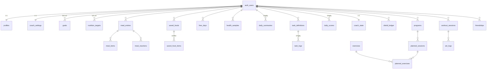

# Thiết kế database

Database: **Supabase Postgres**. Mỗi chức năng có một file thiết kế riêng, **ghi rõ phiên bản**. Mọi thay đổi schema phải đi kèm một migration và cập nhật file tương ứng trong cùng PR.

| File | Module | Chức năng (xem `../FEATURES.md`) | Phiên bản hiện tại |
|---|---|---|---|
| [01-profile.md](01-profile.md) | Hồ sơ & cài đặt | ONB-* | v1 (thiết kế) |
| [02-nutrition.md](02-nutrition.md) | Dinh dưỡng | NUT-* | v1 (thiết kế) |
| [03-health.md](03-health.md) | Sức khoẻ | HLT-* | v1 (thiết kế) |
| [04-tasks.md](04-tasks.md) | Daily Tasks | TSK-* | v1 (thiết kế) |
| [05-coach.md](05-coach.md) | Huấn luyện viên | COA-* | v1 (thiết kế) |
| [06-workout.md](06-workout.md) | Tập luyện, thư viện bài tập, hồi phục cơ (vùng + phần cơ) | WRK-* | v1.3 (thiết kế) |
| [seed/exercises_v1.csv](seed/exercises_v1.csv) | Dữ liệu khởi tạo | WRK-09 | 90 bài, 10 bài/nhóm cơ |
| [07-friends.md](07-friends.md) | Bạn bè | FRD-* | v1 (thiết kế) |
| [CHANGELOG.md](CHANGELOG.md) | Toàn bộ | Lịch sử mọi phiên bản schema theo thời gian | – |

## 1. Quy ước chung

- **Tên**: `snake_case`, bảng số nhiều (`meal_entries`), khoá ngoại `<bảng số ít>_id`.
- **Khoá chính**: `id uuid default gen_random_uuid()`. Bảng 1–1 với người dùng dùng `user_id` làm khoá chính.
- **Chủ dữ liệu**: mọi bảng của người dùng có `user_id uuid not null references auth.users on delete cascade` (xoá tài khoản là xoá sạch dữ liệu).
- **Thời gian**:
  - Lưu `timestamptz` (UTC).
  - Bảng tính theo ngày có thêm `local_date date`, tính theo múi giờ của người dùng (`profiles.timezone`), để "ngày" luôn đúng với người dùng.
- **Giá trị liệt kê**: `text` + `check (... in (...))`, không dùng Postgres enum (dễ thêm giá trị khi migrate).
- **Đơn vị**: lưu đơn vị chuẩn – kg, ml, phút, kcal, gram, mg. Đổi sang lbs chỉ ở giao diện.
- **`created_at` / `updated_at`**: mặc định `now()`; `updated_at` cập nhật bằng trigger dùng chung `set_updated_at()`.

## 2. Bảo mật (RLS)

- **Mọi bảng bật RLS.** Mặc định: chủ dữ liệu được `select/insert/update/delete` dòng có `user_id = auth.uid()`.
- **Bảng chỉ server được ghi** (app chỉ đọc): `daily_scores`, `coach_state`, `shield_ledger`, `stat_snapshots`, `quests`, `boss_battles`, `user_badges`, `daily_summaries`, `nutrition_targets` (khi chỉnh tự động), `ai_requests`. Edge Function dùng service role để ghi.
  - Đây là cách sửa lỗi lớn nhất của bản cũ: người dùng tự sửa được XP và streak.
- **Bảng dùng chung, chỉ đọc**: `exercises`, `badges`, `barcode_products`.
- **Bạn bè**: chỉ được đọc bữa ăn **đã chia sẻ** trong ngày của người đã kết bạn (`07-friends.md`).

## 3. Quy trình phiên bản

1. Đổi schema ⇒ tạo migration mới `supabase/migrations/YYYYMMDDHHMMSS_<module>_<thay-doi>.sql`, ví dụ `20261120090000_nutrition_add_fiber.sql`.
2. **Không bao giờ sửa migration đã chạy**; muốn đổi thì viết migration mới.
3. Cập nhật file module trong thư mục này:
   - tăng phiên bản (v1 → v2);
   - ghi dòng mới vào bảng **Lịch sử phiên bản** của file đó;
   - sửa phần schema cho đúng hiện trạng.
4. Thêm một dòng vào `CHANGELOG.md`.
5. Chạy `supabase gen types` để cập nhật kiểu TypeScript.
6. Tất cả nằm trong **cùng một PR**.

**Đánh số phiên bản:**
- **Thêm** bảng / cột (tương thích ngược) → tăng số phụ, ví dụ v1.1.
- **Đổi tên / xoá / đổi kiểu** (phá vỡ) → tăng số chính, ví dụ v2, kèm ghi chú cách chuyển dữ liệu.

## 4. Sơ đồ quan hệ tổng quát

## 5. Database cũ

Schema của bản cũ (`supabase/migrations/2026060*`, tag `legacy-v0`) **không dùng lại**. Bản mới chạy trên Supabase project mới, bắt đầu từ v1. Tóm tắt schema cũ ở `../legacy/database_schema_summary.md`.
